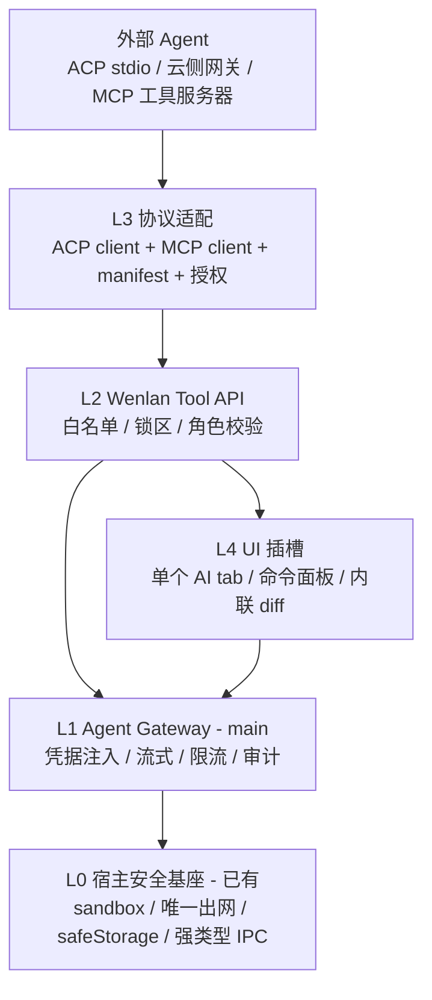

# 文览 AI Agent 接入设计（Agent Gateway）

> 定位：文览接入 AI agent 的**通用底座**——外部成品 agent、云侧网关、本地模型
> 统一从一个 Gateway 进来，全部经白名单工具面触达文档；教学红线（锁区、判分
> 事实、双源分离）在工具层硬性收口。
>
> 互引：
>
> - `edu-client-design.md` —— 教学窗、身份体系、E 里程碑；
> - `course-workspace-design.md` —— 课程工作区边界（工具访问的授权范围）；
> - `wenshu-server/docs/TEACHING-SPEC.md` —— 载荷围栏、判分基线；
> - `wenshu-server/docs/QUESTION-BANK.md` —— quiz 块 schema（题目生成工具的输出契约）；
> - 文运（mdcode2run）—— RunReport / expect= 断言，`exec.run` 的返回体；
> - 生态根目录 `ARCHITECTURE.md` / `TEACHING-PHILOSOPHY.md`。
>
> 状态：**设计草案 v0.2.2**（v0.2 由 zcode 定稿待拍板；v0.2.1 依用户裁决
> 补入五处规格修订，v0.2.2 于 2026-11-15 补入 ACP 轨的实机核查结论）。
> 本文只描述设计，不含任何代码改动；
> 事实核查基于 `wenlan/develop` 当前工作树。§11 各开放问题已附推荐答案，
> 终裁后升生态总纲 ADR；本模块对外命名延后（起名前查 TODO 避免撞名）。
>
> v0.2.1 修订：① 统一 §3.7 / §11.3 协议口径（不引 SDK 但不自造协议）；
> ② 补 MCP 工具服务器注册形状、统一 §1 与 §9 验收口径；③ 把 `utilityProcess`
> 提前到 P2 并补 ACP 子进程隔离硬约束；④ 指明 `quiz.emit` 校验的跨仓入口；
> ⑤ 权限矩阵增加「可用期别」列；⑥ 核实 CodeBuddy Code 2.161.4 原生支持
> ACP，补首个对接对象、工具代理机制、`acp-http` 传输与 env 注入约束
> （§4 / §5.3 / §5.4 / §9 / §11.3）。

---

## 0. 一句话结论

**不要先造"插件系统"。** 成熟编辑器能长出各类 AI 插件，关键不在扩展宿主，
而在三件事解耦：**模型供给**（模型以服务形式供给上层，而非各家直连）、
**编辑器能力**（受控 API，而非 DOM 访问）、**UI 贡献**（声明式挂载点）。
文览缺的正是中间这层。路线定为：**C 协议层打底 → B 插件宿主按需收编**，
A（内置硬编码 AI 面板）只作 P0 验证，不作为终态。

---

## 1. 目标与非目标

| 目标                                               | 非目标                                  |
| -------------------------------------------------- | --------------------------------------- |
| 接第 N 个 Agent = 填一条连接配置，不改源码、不发版 | 不做插件市场 / 在线商店                 |
| Agent 拿不到 API key，也拿不到渲染端编辑器对象     | 不在渲染端直连模型厂商                  |
| AI 写回不破坏光标、撤销栈、实验手册锁区            | 不让 AI 生成判分依据（见 §8）           |
| 教师 / 学生 / 未登录三态工具集可裁剪               | 不改变 D10 双窗口同壳、B 单交互面       |
| 全部外部流量经主进程，可审计、可限流、可断网       | 不引入常驻 Node 服务到用户机器（P0–P2） |

**验收判据**（P2 一次性口径，§9 各期按此拆解）：同一套配置体系下分别接入
① 本地 ACP stdio Agent、② 云侧 SSE 内置循环轨、③ 一个 MCP 工具服务器；
三者都只能触达 L2 白名单工具，且学生端无法调用 `release.*` / `exec.run` /
`quiz.emit`。

---

## 2. 现状事实核查

### 2.1 已有、可直接复用

| 能力                                           | 位置                                                                                        | 复用方式                                                                |
| ---------------------------------------------- | ------------------------------------------------------------------------------------------- | ----------------------------------------------------------------------- |
| 强类型 IPC 契约（四类通道，新增通道三步）      | `src/shared/types/ipc.ts:1-18, 82, 293, 415, 424`                                           | 新增 `agent::*` 通道的正规落点                                          |
| typed preload 桥（`invoke/send/on/once` 泛型） | `src/preload/index.ts:43-85`；暴露 15 个 API 于 `:423-439`                                  | `window.*` 新增一个 `agentAPI`                                          |
| main 唯一出网点；token 只在 main               | `src/main/auth/index.ts:291, 324`；`src/main/ipc/auth.ts:14`                                | `agent::request` 照 `auth::request` 抄，key 在 main 注入                |
| 凭据安全存储                                   | `auth/index.ts:92-113`（safeStorage）、`src/main/dataCenter/index.ts:73-141`（keytar）      | 模型 key 复用 keytar，不进 `preferences.json`                           |
| 登录态与角色（脱敏）                           | `src/shared/types/auth.ts:19-25`（`AuthState.roles`）                                       | 权限矩阵取 `roles`，`isStudent` 只认 roles                              |
| main→renderer 推送范式                         | `src/main/teachingSocket.ts:278, 327-333`（WebSocket → `webContents.send`）                 | 流式 chunk / 工具调用确认照此转发                                       |
| 命令中心运行时注册                             | `src/renderer/src/store/commandCenter.ts:22-24, 58-60`                                      | `bus.emit('cmd::register-command', cmd)` 动态挂 `ai.*` 命令             |
| 命令描述符形状                                 | `src/renderer/src/commands/index.ts:29-38`                                                  | `id/description/shortcut/execute/isVisible`                             |
| 侧栏 tab + 登录门控                            | `src/renderer/src/components/sideBar/index.vue:8-26, 77-80, 85-86`；`store/layout.ts:7, 26` | 加**一个** `ai` tab，`visibleTabs` 现成门控                             |
| 偏好 schema + 广播                             | `src/main/preferences/schema.json`、`preferences/index.ts:44-57`                            | 新增 provider / 授权项                                                  |
| muya 读取 API                                  | `packages/muya/src/muya.ts:249, 253, 263, 649, 657, 664`                                    | `getMarkdown/getTOC/getSelection/getSelectedText/getCursorOffset`       |
| mdcode2run 门面（main 侧）                     | `src/main/ipc/mdcode2run.ts`、`shared/types/mdcode2run.ts`                                  | `stepsOf/traceEntries/fillTodos/guardStep/labReportOf` 作只读或受控工具 |
| 12 语言 i18n                                   | `static/locales/`（12 × 2）、`renderer/src/i18n/index.ts:29-43`                             | 新文案须 12 语言 + `pnpm minify-locales`                                |

### 2.2 缺口（必须补）

| 缺口                                                                  | 证据                                                                                                                                                                                                               |
| --------------------------------------------------------------------- | ------------------------------------------------------------------------------------------------------------------------------------------------------------------------------------------------------------------ |
| 无第三方插件机制：无 manifest / `contributes` / `activate` / 扩展目录 | `CONTRIBUTING.md:9` 明写插件系统是未来愿景；全仓检索零命中                                                                                                                                                         |
| 无 `utilityProcess` / `webview` / `BrowserView` 隔离容器              | `electron.vite.config.ts:45-47` 与 `src/main/config.ts:15-23` 只有 `sandbox:true` / `contextIsolation:true` / `nodeIntegration:false`                                                                              |
| 无任何 LLM 调用、无 MCP / ACP / LSP 客户端、无 SSE / EventSource      | `packages/**` 与所有 `package.json` 检索零命中                                                                                                                                                                     |
| muya 的 `Muya.use()` 只是编译期静态注册内置浮动 UI 工具               | `packages/muya/src/muya.ts:175`、`editor.vue:2015-2019`                                                                                                                                                            |
| 云侧当前无可用模型端点                                                | `wenshu-server/pom.xml:35-37` 注释掉 `yudao-module-ai`；`DefaultController.java:104-107` `/admin-api/ai/**` 返回 NOT_IMPLEMENTED；`application.yaml:152-239` 与 `wenshu-ui-admin/src/views/ai/` 只是配置与页面骨架 |
| engine / mdcode2run 与 LLM 无关                                       | `wenshu-server/engine/README.md:11-16`（无状态投影）、`mdcode2run/AGENTS.md:3`                                                                                                                                     |

### 2.3 最硬的工程坑：写回

`editor.vue:1708-1713` 的宿主写文档路径是 **`setContent` 整篇替换**，源码注释已写明
「resets the document and clears the undo history」；muya **没有 `insertText`**。
AI 流式输出若走这条路，会：丢光标与选区、清空撤销栈、绕过实验手册锁区、
破坏保存基线 `lastSavedHistoryId`（`:1714-1722`）。

> **P1 前置任务**：先在宿主侧实现 `applyPatch`（基于 offset/range 的局部写，
> 保留光标与 undo），再开放任何写类工具。在此之前 `document.patch` 一律禁用。

---

## 3. 设计原则

1. **key 不下渲染端**：模型凭据只在 main，由 Gateway 注入；Agent 侧只见 `modelRef`。
2. **Agent 不碰 muya、不越权读盘**：第三方代码永远拿不到渲染进程对象，只能调
   白名单工具；外部 agent 子进程同样受 §4「子进程隔离硬约束」的工作目录 /
   env / 凭据约束，不得借文件系统绕过 L2。
3. **写回一律 patch**：见 §2.3。禁止整篇 `setContent`，禁止直接写文件绕过 sidecar。
4. **教学事实不可伪造**：判分只比执行事实，顺序事实只来自教师 trace（见 §8）。
5. **单交互面**：只加一个「AI」侧栏 tab + 命令面板条目；不做多 tab、不做按类型细分目录
   （与 B 裁决、课程布局 `../code` 单一工程冲突）。
6. **叠加态**：沿用 D10 / ADR-22，两个 BrowserWindow 共用同一 `app.vue` 壳，
   AI 能力按 `env.type` 与角色裁剪，不换壳、不加第三窗口类型。
7. **用协议、不引 SDK、不自造契约**：外部成品 agent 会话走 ACP（开放协议），
   工具服务器走 MCP。P2 允许**手写协议子集客户端**（不把官方 SDK 引进
   `extraResources`），但报文字段与会话 / 工具语义必须与 ACP / MCP 对齐，不得
   另立一套；完全自造的 JSON-RPC 契约只允许作为 P2 之前的临时过渡形态。

---

## 4. 总体架构



| 层  | 职责                                                                                                                | 进程                               | 是否新增     |
| --- | ------------------------------------------------------------------------------------------------------------------- | ---------------------------------- | ------------ |
| L0  | sandbox / contextIsolation / main 唯一出网 / 凭据落盘 / IPC 契约                                                    | main                               | 否，**别动** |
| L1  | provider 注册、key 注入、流式转发、限流、审计日志、断连与取消                                                       | main                               | 是           |
| L2  | 工具白名单、参数校验、docPath 身份、锁区 range、角色裁剪                                                            | main（权威）+ renderer（只读投影） | 是           |
| L3  | ACP client（外部成品 agent 子进程，跑在 `utilityProcess`）+ MCP client（工具服务器）+ manifest、启停与逐工具授权 UI | main                               | 是           |
| L4  | 单个 AI 侧栏 tab、`ai.*` 命令、内联 diff 预览、状态栏叠加指示                                                       | renderer                           | 是           |

L1 与 L2 必须分开：**Gateway 管"钱和管道"，Tool API 管"能不能碰文档"**。
合并会导致鉴权散落在网络代码里，后续加 provider 必然漏检。

**三条接入轨**（汇入同一套 L2 工具面与 L4 UI，权限模型一致、不开后门）：

1. **内置循环轨**：L1 Gateway 自跑 tool-calling 循环，覆盖云侧网关（SSE）与
   直连 provider；
2. **ACP 轨**：外部成品 agent 以子进程托管——开放协议（JSON-RPC over stdio，
   文览为 client），会话生命周期、流式输出、权限请求映射到 `agent::*` 与授权
   对话框；多家命令行 agent 已原生支持或经适配器接入，实现一次 client 即吸收
   整个生态，替代自造会话契约；
3. **MCP 工具轨**：文览作 MCP client 消费工具服务器（stdio / streamable
   HTTP），供内置循环调用——MCP client 是「文览消费工具」，不是外部 agent
   入口；外部 agent 会话归 ②。

**子进程隔离硬约束（P2 前置）**：ACP 轨 ② 的第三方 agent 子进程一律跑在
`utilityProcess`（或等价受限子进程）中，工作目录钉在课程工作区、`env` 走白名单
（不继承父进程环境；确需的模型 key 由 main 显式注入，见 §5.4）、不授予任意路径
文件读写；`utilityProcess` 因此从 P3
**提前到 P2**（§9）。否则第三方 agent 可绕过 L2 白名单直读本机文件——§3.2 的
白名单约束只有靠进程级隔离才能真正落地。工具服务器（轨 ③）的 stdio / HTTP 连接同样
受此约束，远端 MCP 端点须在 provider 白名单内。

**ACP 轨对接对象已核实（2026-11-15，依据本机 `codebuddy --help` 与官方 ACP 文档）**：
CodeBuddy Code 2.161.4 原生支持 ACP，作为 **Agent Server**，文览的角色是
**ACP client**（与 Zed 同侧）：
`codebuddy --acp`（stdio，ndjson）或 `codebuddy --serve --acp
--acp-transport streamable-http`（HTTP）。协议侧已具备权限请求交互、实时流式、
`available_commands_update` 命令列表推送，以及**工具代理机制**——客户端声明
`fs.readTextFile` / `fs.writeTextFile` / `terminal` 能力后，文件与终端操作会
代理回客户端执行。这给上面的隔离约束补了一条更根本的解法：**文览声明 fs
能力，把文件读写收进 L2 白名单与锁区校验**，而不是只靠 `utilityProcess` 兜底；
未声明能力时 CLI 会自行读盘，进程级隔离仍必须保留。厂商私有
`_meta['codebuddy.ai/*']` 扩展只作可选增强，不进入协议依赖（避免绑死单一 Agent）。
尚未实跑 ACP 握手；P2 第一步应补一次最小 `initialize` / `session/new` 冒烟，
确认权限请求与 fs 能力代理的实际报文形态。

---

## 5. 接口规格（草案，命名待评审）

### 5.1 IPC 通道 — 追加到 `src/shared/types/ipc.ts`

```ts
// IpcInvokeChannels
'agent::list':          { args: []; ret: AgentDescriptor[] }
'agent::start':         { args: [opts: { agentId: string }]; ret: AgentActionResult }
'agent::stop':          { args: [opts: { sessionId: string }]; ret: AgentActionResult }
'agent::send':          { args: [opts: AgentSendOptions]; ret: { messageId: string } }
'agent::tool-approve':  { args: [opts: { callId: string; approved: boolean }]; ret: void }
'agent::set-provider':  { args: [opts: AgentProviderConfig]; ret: AgentActionResult }

// IpcMainEventChannels（main → renderer，照 teachingSocket 的 webContents.send）
'agent::chunk':     [payload: AgentChunk]      // 增量文本 / 思考 / 用量
'agent::tool-call': [payload: AgentToolCall]   // 待授权或已执行的工具调用
'agent::status':    [payload: AgentStatus]     // connecting / ready / error / stopped
```

注册：`src/main/ipc/index.ts:20-39` 的 `registerSandboxIpcHandlers()` 加
`registerAgentHandlers()`；preload 在 `:423-439` 暴露 `agentAPI`。
遵循 `ipc.ts:14-18` 的三步契约：加接口 → main 挂 handler → preload 挂调用。

### 5.2 Wenlan Tool API 白名单

| 工具               | 读/写          | 依赖 `docPath` | 教师 | 学生             | 说明                                                                                                                                                                                                                                                                |
| ------------------ | -------------- | -------------- | ---- | ---------------- | ------------------------------------------------------------------------------------------------------------------------------------------------------------------------------------------------------------------------------------------------------------------- |
| `document.read`    | 读             | 是             | ✓    | ✓                | `getMarkdown` / `getSelection` / `getCursorOffset`                                                                                                                                                                                                                  |
| `document.toc`     | 读             | 是             | ✓    | ✓                | `getTOC` / `getBlockStartLines`                                                                                                                                                                                                                                     |
| `document.context` | 读             | 是             | ✓    | ✓                | courseKey / releaseId / 体裁（body / project）/ 锁区范围                                                                                                                                                                                                            |
| `document.patch`   | **写**         | 是             | ✓    | 仅 todo 区       | **P1 前禁用**；走 `applyPatch`，带 range 校验                                                                                                                                                                                                                       |
| `lab.todo.read`    | 读             | 是             | ✓    | ✓                | `fillTodos` 的输入视图，只读                                                                                                                                                                                                                                        |
| `lab.todo.fill`    | **写**         | 是             | ✓    | ✓（仅本人 todo） | 复用 `mdcode2run.fillTodos`，不碰正文                                                                                                                                                                                                                               |
| `trace.read`       | 读             | 是             | ✓    | ✓（本人事实）    | `teacherTraceOf` / `stepSources` / `localRuns`，**只读**                                                                                                                                                                                                            |
| `exec.run`         | **写**         | 是             | ✓    | 按课程策略       | 真实调用 `runDocument` / MR 执行。**教师创作档 = 自修回路**：agent 写码 → 执行 → 读 expect= 断言 → 修，RunReport 回灌；**课堂/学生档按课程策略**；任何场景不产出判分事实（§8.2）                                                                                    |
| `course.tree`      | 读             | 否             | ✓    | ✓                | 只读课程 / 讲义目录                                                                                                                                                                                                                                                 |
| `release.publish`  | **写**         | 否             | ✓    | ✗                | 教师专属                                                                                                                                                                                                                                                            |
| `release.restore`  | **写**         | 是             | ✓    | ✓                | 讲义还原到服务器最新（AI 改动必须可一键回滚）                                                                                                                                                                                                                       |
| `deck.preview`     | 读             | 是             | ✓    | ✓                | 本地 md2slides 投影，只读                                                                                                                                                                                                                                           |
| `quiz.emit`        | **写**（产题） | 是             | ✓    | ✗                | 按 `wenshu-server/docs/QUESTION-BANK.md` schema 生成 quiz 载荷围栏；输出必须过 md2slides 的 quiz 围栏校验（`md2slides/core/quiz/fence.js`、`parse.js`；wenlan 侧走 vendored `resources/md2slides/` 的同一版本，随 `scripts/sync-md2slides.mjs` 同步）；仅教师创作档 |

> `quiz.emit` 是产题工具，与 `wenlan/TODO.md` 中尚未实现的 `/quiz` 斜杠命令
> （问答题模板内容待定）是两件事，互不阻塞。校验器在独立仓，改 md2slides `core/`
> 后须按仓内护栏重跑 `pack:marktext` + `sync-md2slides.mjs`，别在 wenlan 里
> 另写一份解析器。

**明确不提供**：`trace.write`、`journal.write`、`file.write`（任意路径）、
`preferences.write`、`auth.token`、`eval` / 任意 shell。

### 5.3 Agent manifest（P2）

```json
{
  "id": "lab-tutor",
  "name": "实验答疑",
  "transport": { "type": "acp-stdio", "command": "node", "args": ["agent.mjs"] },
  "toolServers": [{ "type": "mcp-stdio", "command": "node", "args": ["tools.mjs"] }],
  "scopes": ["document.read", "lab.todo.read"],
  "writeScopes": [],
  "models": ["wenshu://default"],
  "roles": ["teacher", "student"],
  "requiresDocPath": true
}
```

`transport.type`（Agent 会话来源）：`acp-stdio`（外部成品 agent，走 ACP，如
`codebuddy --acp`）/ `acp-http`（`--serve --acp --acp-transport
streamable-http`）/ `sse`（云侧网关，内置循环轨）/ `builtin`（文览内置 agent）。
`toolServers`（**工具服务器注册，与会话来源分开**）：`mcp-stdio` / `mcp-http`，
每项带 `command` / `args` 或 `url`，产物只作为内置循环轨可调用的工具，不产生
独立会话；端点须在 provider 白名单内，并受 §4 子进程隔离约束。MCP 工具服务器
不是第二条 Agent 会话入口，别与 `acp-stdio` 混用。
`scopes` 是**能力上限**，不是授权结果：每次会话仍需 UI 逐工具确认；
`writeScopes` 为空的 Agent 在 `document.patch` 上恒被拒。
`roles` 与 `AuthState.roles` 取交集后才是本次会话的可用工具集。

### 5.4 凭据、偏好与流式

- 模型 key：keytar（`dataCenter/index.ts:73-141`）；`preferences/schema.json` 只放
  provider 名称 / baseURL / 启停开关 / 授权记录，**不放密钥**。
- **两级密钥分域**：教师本机创作 = 本地 provider，key 经 keytar 只在 main；
  课堂 / 学生侧 = 云侧网关，key 服务端持有 + 配额 + 审计，学生端任何位置不出现
  明文 key。学生侧轨随 §11.1 的推荐答案排期。
- provider 形态（P0 起一个接口覆盖）：OpenAI-compatible 自定义 baseURL +
  Anthropic 原生 + 本地 Ollama / LM Studio。
- 流式：P0 可用 `agent::send` + `agent::chunk`（main 侧 `fetch` 读 SSE 或 WS，
  逐帧 `webContents.send`），照 `teachingSocket.ts:327-333` 脱敏转发；
  **不要在 CSP 里进一步放开渲染端直连**（`renderer/index.html:7-17` 当前已允许 `https:`）。
- 取消：`agent::stop` 必须同时 `AbortController.abort()` + 通知对端；
  窗口关闭时按 sessionId 全量清理，参考 `windowManager` 的窗口生命周期。
  ACP 走会话级权限请求，headless stream-json 走
  `control_request` + `subtype: "interrupt"`（**关 stdin 不等于中断**）。
  Windows 下 stdio 子进程注意：`npx` / `uvx` 显式解析 `.cmd`、UTF-8 编码、
  退出 kill 整棵进程树。
- ACP 子进程的模型凭据：若需 `CODEBUDDY_API_KEY`，由 main 按 env 白名单**显式
  注入**（不继承父进程环境、不落 `preferences.json`）；国内版须同时设
  `CODEBUDDY_INTERNET_ENVIRONMENT=internal`，海外版不设、iOA 版设 `ioa`。
  教学侧角色仍以 `AuthState.roles` 为唯一权威，不采信 ACP `authenticate` 回包
  里的 `codebuddy.ai/userinfo`。
- 审计：每次工具调用记 `{ts, agentId, tool, docPath, role, approved, ok}`，
  本地日志不上传，教学判分链路**不读**这份日志。

---

## 6. 关键流程

**① 会话**：渲染端收集「选区 + 文档上下文」→ `agent::send` → Gateway 注入 key /
tenant → 模型流式 → `agent::chunk` 逐帧到面板 → 结束写用量。

**② 工具调用**：模型请求工具 → Gateway 转 `agent::tool-call` →
L2 校验（白名单 / scope / role / docPath / 锁区 range）→
写类工具弹内联授权（diff 预览）→ 用户确认 → 执行 → 结果回灌模型。
**校验在 main 做，渲染端只展示**，不信任渲染端传来的 `approved=true`。

**③ 写回**：`document.patch` 把 `{docPath, baseOffset, ops[]}` 交给宿主
`applyPatch`；拒绝条件：目标 range 与锁区求交非空、`docPath` 无可执行文档身份、
体裁为 project 档但试图改正文、并发基线不匹配（文档已被用户改动）。
拒绝后返回结构化错误给 Agent，不静默丢弃。

**④ 失败**：网络错误 / 限流 / 对端崩溃 → `agent::status` 推 error，
面板保留已产生的文本但不自动写回；**任何情况下不自动重试写类工具**。

---

## 7. 权限矩阵

| 角色（取 `AuthState.roles`） | 可见工具（能力上限）                                                                               | 禁止                                                                                          | 可用期别                                                                 |
| ---------------------------- | -------------------------------------------------------------------------------------------------- | --------------------------------------------------------------------------------------------- | ------------------------------------------------------------------------ |
| 教师                         | 全表（含 `release.*`、`exec.run`、`quiz.emit`）                                                    | —                                                                                             | P0 起（P0 全局纯只读，写类自 P1 随 `applyPatch` 开放）                   |
| 学生（`wenshu-student`）     | `document.read/toc/context`、`lab.todo.*`、`trace.read`（本人）、`release.restore`、`deck.preview` | `release.publish`、`exec.run`（默认）、`quiz.emit`、`document.patch` 正文区、任何班级全量数据 | **P2 之后且云侧网关上线后**；P0–P1 不启用，上线后写类仍按 §11.4 默认全禁 |
| 未登录                       | 仅 `document.read/toc/context`（本地文件）                                                         | 全部云侧与教学工具；**「AI」tab 按 `visibleTabs` 门控决定是否显示**                           | P1 起（仅本地只读）                                                      |

> 本表是**能力上限规格，不是当前可用清单**：P0 全局纯只读（§9）；学生侧 AI 依赖
> 云侧 `yudao-module-ai`（当前禁用，`wenshu-server/pom.xml:35-37`），随 §11.1
> 排期上线；上线后写类仍按 §11.4 默认全禁，须教师按课程策略显式开。

`isStudent` 只认 roles，不用 hash 回退（B 裁决已落地）。

---

## 8. 教学红线（硬性，不可协商）

1. **锁区**：实验手册仅 `todo` 区可填，工具层按 range 拒绝；讲义可写但必须能
   `release.restore` 一键还原到服务器最新。
2. **判分事实**：`TEACHING-PHILOSOPHY.md` 的因果链是
   「规范 code → 规范手册 → 学生独立实现 → 优秀报告」。判分只比执行事实，
   顺序事实只来自教师 trace。故：**Agent 不得写 journal / trace，不得代跑
   `runDocument` 生成假执行记录，不得替学生产出作为判分依据的 code 或报告**。
   双源分离（教师 trace 只读定序 / 学生事实 `localRuns`）必须保持。
   **场景分流**：教师创作档下 `exec.run` 作为自修回路放开（见 §5.2）；课堂 /
   学生档按 §7 矩阵与课程策略收口。两类场景下 agent 产出均不落 journal、
   不进判分链。
3. **身份**：AI 工具依赖 `docPath`；无路径的学生讲义目前没有可执行文档身份
   （E4 未完成），需先补身份再开放工具，否则 AI 改写无处锚定、也无法还原。
4. **凭据与网络**：key 只在 main；外部 Agent 不直连；断网时 AI 面板降级为只读，
   不影响讲义 / 手册 / 放映主链路。
5. **课堂漂移**：讲义可写后「按页跟随」会与 AI 异步改写冲突；写类工具在
   课堂会话进行中默认禁用，需教师显式开启（与三类教学模型粒度字段一并设计）。

---

## 9. 分期与验收

| 期                      | 范围                                                                                                                                                 | 主要改动点                                                                                                                                                                                                      | 验收                                                                                                                                                                                                                              |
| ----------------------- | ---------------------------------------------------------------------------------------------------------------------------------------------------- | --------------------------------------------------------------------------------------------------------------------------------------------------------------------------------------------------------------- | --------------------------------------------------------------------------------------------------------------------------------------------------------------------------------------------------------------------------------- |
| **P0** 能跑的面板       | 一个内置 echo / 单 provider Agent                                                                                                                    | `agent::*` 通道；`main/ipc/agent.ts`；preload `agentAPI`；侧栏 `ai` tab（`store/layout.ts:7`、`sideBar/index.vue:77-80,20-26,45-48`、12 语言）；`cmd::register-command` 挂 `ai.*`；`schema.json` 加 provider 项 | `agent::list` 返回内置 Agent；12 语言键齐、`pnpm minify-locales` 通过；eslint + `vue-tsc` + 单测（基线 1368）全绿；**纯只读，无任何写类工具**                                                                                     |
| **P1** 工具化（最关键） | `applyPatch` + Tool API + 权限矩阵                                                                                                                   | 宿主侧 `applyPatch`（muya 无 `insertText`）；L2 白名单与 range 校验；role 裁剪；审计日志                                                                                                                        | 单测覆盖：光标偏移保持、undo 栈不丢、锁区写入被拒、学生调 `release.publish` 被拒                                                                                                                                                  |
| **P2** 协议化           | ACP client（外部成品 agent 子进程）+ MCP client（stdio + streamable HTTP）+ `utilityProcess` 隔离 + manifest（`transport` / `toolServers`）+ 授权 UI | L3；逐工具授权；`scopes` / `writeScopes` 强制；断连与取消；子进程工作目录 / env / 凭据隔离（§4）                                                                                                                | 按 §1 统一口径：ACP 轨**以本机 `codebuddy --acp`（2.161.4）为首个对接对象**，另接云侧 SSE 内置循环与一个 MCP 工具服务器，逐一验证白名单与角色裁剪；声明 fs 能力后文件操作须走 L2 代理，未声明时第三方子进程读课程根之外路径须被拒 |
| **P3** 可选收编         | 扩展签名 + 本地扩展目录 + 扩展生命周期（复用 P2 已落地的 `utilityProcess`，不重复建设）                                                              | 仅当 P2 真出现高频第三方扩展再做                                                                                                                                                                                | 扩展进程崩溃不拖垮主窗口；禁用扩展后工具与命令全部注销                                                                                                                                                                            |

**工程护栏（沿用仓内既有约定）**：pre-commit 对 `src/**/*.ts` / `test/**/*.ts`
只跑 `eslint --fix`，不要对 TS 跑 `prettier --write`；改完手动 `vue-tsc`；
新增 i18n 键须 12 语言 + `minify-locales`；e2e 跑 `out/` 且须
`NODE_ENV=production` 重建；只本地 commit、不推送。

---

## 10. 与既有决策的关系

| 决策                          | 约束                                                                                                                                                                     |
| ----------------------------- | ------------------------------------------------------------------------------------------------------------------------------------------------------------------------ |
| D10 / ADR-22 双窗口同壳       | 两个 BrowserWindow 共用同一 bundle 与 `app.vue`；AI 面板是叠加态，不换壳、不加第三窗口类型                                                                               |
| B 单交互面                    | 只加一个「AI」tab；侧栏多 tab 方案已否决（与 12 语言及 B 冲突）                                                                                                          |
| 三类教学模型（路线 1/2 并存） | 小实验 = body/method/class，md 内作答 + 锁区；章节综合实践 = project + IDEA 写 `code/`。`document.patch` 须按体裁分策略；`StudentRelease` 缺粒度字段，服务端发布时需快照 |
| 课程布局 `{课程}/{doc,code}`  | `mr-job.projectDir` 从 `doc/` 指 `../code`；工具不得跨出课程目录                                                                                                         |
| 双源分离 A                    | 教师 trace 只读定序、学生事实 `localRuns()`；AI 不进 `setTeacherTrace()`，不落 sidecar                                                                                   |
| E4（未完成）                  | 无路径学生讲义缺可执行文档身份，是 §8.3 的前置依赖                                                                                                                       |

---

## 11. 待拍板（已附推荐答案，不阻塞 P0）

1. **模型供给**（三轨如何并存、默认哪个）：推荐**并存、默认教师本机直连**——
   P0 起开放 OpenAI-compatible 自定义 baseURL + Anthropic 原生 + 本地
   Ollama 三种 provider 形态（一个接口覆盖主流国内端点与校内网关 / 中转）；
   云侧 `yudao-module-ai` 随学生侧 AI 一起上线（key 服务端持有 + 配额 + 审计）；
   本地 Ollama 覆盖机房离线。
2. **机房离线**：推荐「入口保留、离线横幅、模型类功能置灰」——AI tab 显示但
   降级，主链路（讲义 / 手册 / 放映）不受影响；配本地 Ollama 后可部分恢复。
3. **协议依赖体积**：推荐 **P2 手写 ACP / MCP 协议子集客户端**（stdio 传输 +
   会话 / 工具 / 授权三族方法），不把官方 SDK 引进 `extraResources`；报文字段与
   协议对齐、不自立语义（见 §3.7，「不引 SDK」≠「自造协议」），协议面收窄到
   实际用到的能力，生态需要时再评估官方 SDK。首个联调对象直接用本机已装的
   `codebuddy --acp`，不必自造测试 Agent。
4. **学生端写能力（防代做）**：推荐**默认全禁**（含 `lab.todo.fill` 的 AI
   调用与 `document.patch`）——学生侧 AI 答疑只读；某课程确需放开时由教师按
   课程策略显式开（课程级一次性开关，不违反教师零额外维护红线）。
5. **课堂跟随 vs AI 改写**：推荐引入硬规则——课堂会话进行中写类工具默认冻结，
   教师显式解冻；与三类教学模型粒度字段一并设计（§8.5）。
6. **文档归属**：本文留 `wenlan/docs/design/`（与 edu-client 同级）；拍板后
   升生态总纲 ADR。

---

## 附录 A 现有可扩展点清单

命令中心运行时注册 · 静态命令表 + `descriptions.ts` · 主进程 `CommandManager` ·
IPC 四类通道契约 · preload 15 个 contextBridge API · 侧栏 tab（`visibleTabs` 门控）·
状态栏叠加 · 应用菜单模板（12 个）· 右键菜单工厂 · muya `Muya.use()` 内核 UI 插件 ·
muya 读取 API · 偏好 schema + migrations · safeStorage / keytar · `auth::request` 代理 ·
课堂 WebSocket 推送 · 12 语言 i18n · 双窗口同壳默认路由。

## 附录 B 关键文件索引

```
wenlan/packages/desktop/src/shared/types/ipc.ts            IPC 契约（新增通道第一步）
wenlan/packages/desktop/src/preload/index.ts              contextBridge（第三步）
wenlan/packages/desktop/src/main/ipc/index.ts              handler 汇总（第二步）
wenlan/packages/desktop/src/main/auth/index.ts            唯一出网点 / safeStorage
wenlan/packages/desktop/src/main/teachingSocket.ts        流式推送范式
wenlan/packages/desktop/src/main/preferences/schema.json  偏好 schema
wenlan/packages/desktop/src/renderer/src/store/commandCenter.ts  运行时命令注册
wenlan/packages/desktop/src/renderer/src/components/sideBar/index.vue  tab 与门控
wenlan/packages/desktop/src/renderer/src/components/editorWithTabs/editor.vue  setContent 坑
wenlan/packages/muya/src/muya.ts                         编辑器 API（无 insertText）
wenlan/packages/desktop/static/locales/                   12 语言 × 2
```
