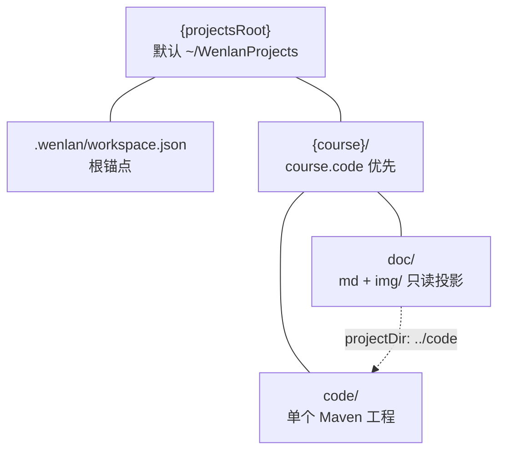
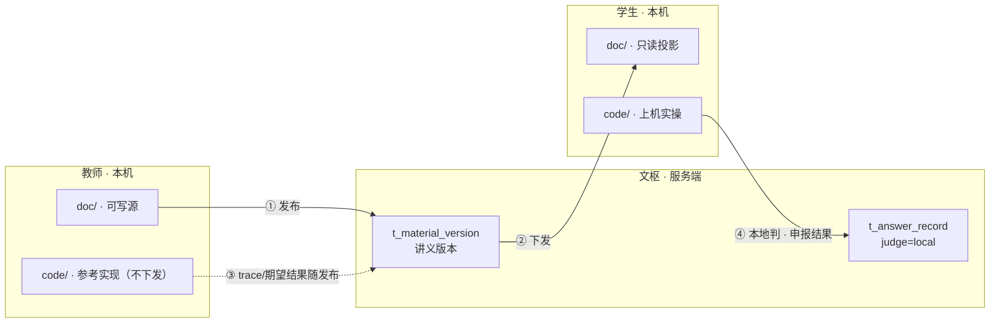

# 课程工作区设计（edu-client · course workspace）

> 定位：教学客户端（文览 × 文枢 wenshu-server）的**本地课程工作区**——把课程资料
> 与上机实操代码落成一个用户可见、JetBrains 式的 projects 目录树，并用登录身份驱动
> 目录语义。
>
> 互引：
>
> - `edu-client-design.md` —— E 里程碑、同 bundle 多路由、身份体系（E1）、学生工作台（E2）、教师讲台管理（D9/E6）；
> - `TEACHING-SPEC.md` —— 「章工作目录」、实验/实训本地判、载荷围栏断言；
> - `QUESTION-BANK.md` —— 题目归属与判分（本文不涉判分细节）。
>
> 状态：**设计草案**（2026-11-09 定稿）。§7 决策 D4/D5/D6 已拍板；
> **2026-11-13 修订 D12（以用户实际磁盘布局为准）**：md 全部落 `doc/`，`code/`
> 本身就是一个 Maven 工程、不再按工程名分目录。§1/§2 骨架、§6 落点、§7 D12
> 据此改写；§3/§4/§5/§9 原本就按 `doc/` + `code/` 写，改后全文自洽。
> 同日补 D7（发布主路径改到文览）、D8（图片资产随版本锚定，见 §9）、
> **D9（B 全原生：教师侧全量管理进文览，浏览器不再是教师入口，见
> `edu-client-design.md` / `ARCHITECTURE.md` ADR-21）**、**D10（叠加态：两个
> 实例共用同一套 `app.vue` 壳，教育功能只做叠加，ADR-22）**。本文 §2 目录
> 骨架在 D9/D10 下不变：`projects` 根在**教育实例的「文件」tab 默认打开**
> （仍可切其他文件夹，「教学」tab 是服务端课程/讲义树、保持独立不动），
> 不重构布局（D10 20:28 细化：左下登录 / 右下视图切换 / 顶部菜单栏全部保留）。

## 1. 需求与已拍板决策

- **动机（两个真实缺口）**：
  1. 实验（机房实训，`purpose=2`，本地判）需要一个**真实、可写、长期**的本地工作目录，
     承载学生代码与实验产物。TEACHING-SPEC §3.2 的「章工作目录」只是隐含概念，
     从没在物理文件系统定过位置。
  2. 教师需要一个本地目录组织「课程资料（代码 + 文档）」，再发布到服务端。
- **已拍板**：
  - **范围**：本次只产出本设计文档，不写产品代码。
  - **课程扁平**：projects 根下不按学校（租户）分层，直接 `{course}/`。
  - **doc 只读投影**：学生侧讲义从服务端拉取落盘只读，不做双向同步。
  - **code 不按身份、也不按工程分目录**（D6 + D12 修订 2026-11-13）：不建
    `teacher/`、`student/`、学号子目录，也不建 `code/{工程名}/`——目录语义由登录态
    身份决定（PC 是个人使用，一台机器同一时刻只有一个登录身份）。`code/` 本身就是一个
    Maven 工程，学期内所有实验在同一工程上累加成型（`requires` 骨架依赖据此成立）。
  - **md 集中在 `doc/`**（D12 修订 2026-11-13）：讲义/实验/实训/作业/考试与 `img/`
    一起落 `doc/`，学生侧是只读投影。

## 2. 目录结构

```
{WenlanProjects}              ← 根目录（配置项 projectsRoot，默认 ~/WenlanProjects）
├─ .wenlan/workspace.json     ← 根锚点：{ schemaVersion: 1, kind: 'course-workspace' }
└─ {course}/                  ← 课程目录（course.code 优先，回退 name 的 slug）
    ├─ doc/                   ← 讲义层：md + 图片（学生只读投影）
    │   ├─ {节次}-{用途}-{主题}.md   ← 讲义 / 实验 / 作业 / 测试 / 考试
    │   ├─ img/{讲义名}/…            ← 存量 Typora 相对引用，不改名不迁移
    │   └─ assets/
    ├─ code/                  ← 单个 Maven 工程（IDEA 直接打开这一层）
    │   ├─ pom.xml
    │   ├─ src/main/java/…
    │   └─ data/ …
    └─ software/              ← 可选：课程自带工具 / 安装包
```

`projectDir` 的基准是**讲义所在目录**（`doc/`），工程在同级 `code/` ⇒ project 档讲义
一律写 `projectDir: ../code`（`lib/mr/index.js` 的 `path.resolve(docDir, projectDir)`）。



- **md 一律落 `doc/`**（D12 修订 2026-11-13）：讲义/实验/实训/作业/考试都在
  `{course}/doc/`，图片按 `img/{讲义名}/` 与 md 同层，相对引用 `img/…` / `./img/…`
  原样可用。文件名自带节次与用途，不在课程根平铺。
- **文件命名** = `{节次}-{用途}-{主题}.md`，用途词表固定：讲义 / 实验 / 实训 / 作业 /
  考试（D13 词表 v2；purpose 1/2/6/3/5，4 测试废弃并入 5）。不鼓励自创词——各学生机
  目录一致才可按名索引与下发对账。
- **`code/` 本身就是一个 Maven 工程**（D12 修订）：`pom.xml`、`src/main/java/…`、
  `data/` 直接在 `code/` 下，IDEA 打开 `code/` 这一层；学期内按实验累加、课程结束即
  成型。不建身份子目录，也不按工程名再分一层——`requires` 骨架跨实验累加正是靠
  单一工程成立（按工程分会每换一个实验换一个工程，骨架无法累加）。
- **`projectDir` 相对讲义目录**：md 在 `doc/`、工程在同级 `code/` ⇒ project 档写
  `projectDir: ../code`；`fillTodos` / `checkRequires` 与 `runDocument` 共用该基准。
- **引擎只读 `.java`**：`pom.xml` 归 IDE 用，引擎用自己的 classpath 白名单编译提交；
  发布物下发只写/覆盖 md 与图片，**绝不删除或覆盖 `code/` 下学生工程**，也绝不下发
  骨架或参考实现（D15：教师 `code/` 永不下发）。

- **根锚点 `.wenlan/workspace.json`**：区别于普通文件夹，登录校验与课程目录创建都
  以此文件为准（目录可被用户手动挪走，重定位靠它识别）。
- **课程目录命名**：`course.code` 优先（varchar，ASCII 稳定、不撞名、可做 path 安全
  标识）；`code` 为空时回退 `name` 的 slug。
- **doc 内文件命名** = 讲义名 `material.name`（`.md` 后缀，可带节次前缀）；该讲义的
  图片落 `doc/img/{materialName}/`，沿用存量 Typora 讲义的相对引用习惯，不改名、不迁移。

## 3. 身份决定语义（目录结构不区分角色）

登录态身份（教师 / 学生）由服务端 RBAC 角色判定（D1 已定，师生同为 `system_users`）。
**同一棵树，两种裁剪**：

| 目录    | 教师                                               | 学生                                     |
| ------- | -------------------------------------------------- | ---------------------------------------- |
| `doc/`  | 可写（作者源：md + 图片，本地编辑 → 发布到服务端） | 只读投影（md + 图片整包下发，N3 只读锁） |
| `code/` | 可写（参考实现 + 判分基线源，**永不下发**——D15）   | 可写（上机实操，本地判分的断言扫描根）   |

教师要看学生代码走**服务端**（成绩册 / 答题记录），不落本地——PC 个人使用，无需
在本机堆全班学生目录。

## 4. 同步方向单向化

每个目录**只有一个真相源、一个流向**，绝不做 Git 式双向同步（这是整个方案能否站住的核心）：

| 资产        | 真相源 | 流向                                                      | 触发时机              |
| ----------- | ------ | --------------------------------------------------------- | --------------------- |
| 教师 `doc`  | 本地   | 本地 → 发布到 `t_material_version`（md + 图片随版本）     | 文览「发布到文枢…」   |
| 学生 `doc`  | 服务端 | 服务端 → 本地只读投影（md + 图片整包）                    | 登录 / 打开课程时拉取 |
| 教师 `code` | 本地   | **不下发**：跑判分基线（期望结果）、录 trace 随发布物下发 | 发布时                |
| 学生 `code` | 本地   | 本地判分 → 申报 `t_answer_record(judge=local)`            | 校验通过时            |

- **发布入口定性（D7 → D9）**：主路径是文览主窗口「发布到文枢…」——本地文件
  系统在手，md 与 `img/` 引用一次收齐。D9 进一步把教师侧全量管理也收进文览
  **原生**视图，浏览器不再是教师日常入口（`wenshu-ui-admin` 仅运维/应急备用）。
  详见 `edu-client-design.md` §4.1 / §5.4、`ARCHITECTURE.md` ADR-21；提交协议
  见本文 §9。



- **学生 `code` 只回传结果**：代码本体留在学生机，服务端只收限长证据与判分记录，与 TEACHING-SPEC §五「服务端判 ≠ 服务端跑代码」一致——本地判分，服务端只比对证据。
- **教师 `doc` 不回落**：发布后本地仍是源，服务端是版本化副本；改本地 → 再发布成新版本，不做拉回覆盖。

## 5. 生命周期

| 阶段               | 动作                                                                                                                                    |
| ------------------ | --------------------------------------------------------------------------------------------------------------------------------------- |
| 安装时（可选）     | 安装器在「选择安装位置」后提供「课程工作区位置」页：可自定义，默认 `~/WenlanProjects`，可原样保留；交接文件只在首次启动且偏好为空时采用 |
| 登录后（教育账号） | 主路径：校验 `projectsRoot`（空→落默认路径并回写）→ 建目录与 `.wenlan/workspace.json` 锚点 →「文件」tab 默认打开；拉取「我参加的课程」  |
| 运行期更换         | 「教学」菜单 →「更换课程工作区位置…」；切去别的文件夹后可「打开课程工作区」切回                                                         |
| 首次进入某课程     | 惰性 `mkdir doc/ code/`，写 `.wenlan/workspace.json`                                                                                    |
| 学生拉取           | 该课程已下发讲义落 `doc/`（只读）；`code/` 不下发任何东西（D15）——骨架由学生按讲义指引自建（TEACHING-SPEC §3.6）                        |
| 教师写入           | `doc/` 本地编辑 → 发布；`code/` 写参考实现 → 跑判分基线、录 trace，不下发                                                               |

## 6. 与既有设计的边界

- **所有发布物一律落 `projects`**（D11，2026-11-13 裁决；隐藏副本暂缓）：

  | 发布用途（purpose）                      | 本地落点                                         | 可见性      | 判分                 |
  | ---------------------------------------- | ------------------------------------------------ | ----------- | -------------------- |
  | 讲义（1，资料查阅）                      | `{course}/doc/{节次}-讲义-{主题}.md`             | 可见 · 只读 | 不判分               |
  | 实验（2，机房实训）/ 实训（6，综合实训） | `{course}/doc/{节次}-{用途}-{主题}.md` + `code/` | 可见 · 可写 | 本地判（断网可判）   |
  | 作业（3）/ 考试（5，测验并入考试）       | `{course}/doc/{节次}-{用途}-{主题}.md` + `code/` | 可见 · 可写 | 服务端判（证据回传） |

  原「3/4/5 落 `~/.wenlan/coursework/` 隐藏副本」**暂不启用**：实操型答卷要用 IDE
  编辑工程，路径藏不住（学生会知道，也无需隐藏）；**安全靠下发时剥离答案与载荷
  （`variant=assignable`），不靠目录隐藏**。`coursework` 保留为将来「防篡改副本」
  场景的储备，启用时再议。

- **实操型发布物 = 讲义作判分器**（2026-11-13）：`scaffold: project` 的实验讲义只写
  题面、输入与断言，学生工程就是课程目录下那一个 `code/`（IDEA 直接打开它；讲义写
  `projectDir: ../code`，相对 `doc/` 解析）；点「运行整份作业」由引擎编译、提交并核对断言，
  学生看到的是 `code/` 下自己的真实文件。一份 md 一个 scaffold：**讲义 = 可运行示例
  （body/class 档），实验 = 判分器（project 档）**，两者分文件；同一份文档内「示例
  单元级可跑（jshell）+ 工程判分（mr 管线）」已支持（普通块归主引擎、`map/reduce`
  等归管线），但**不得放完整作业实现**——那是载荷剥离要删的对象，也是抄答案的源头。

- **进侧栏，但不与常规文件树混根**（D10 21:07 定稿）：`projects` 根以「教学」tab 的
  **独立树**呈现，与「文件 / 大纲」tab 并列；常规 `openFolder` 根（`mt::open-directory`）
  仍是原样单根，切 tab 换树，不在同一棵树里塞两个分组。这是 JetBrains 式体验的根基。
  教学树内按用途分五组（D14：讲义 / 实验 / 实训 / 作业 / 考试，分组键 = 文件名用途前缀）。

- **doc 只读锁**：学生侧 `doc/` 文件挂只读（对齐 N3 只读引擎），杜绝「编辑器里改讲义回传污染教师模板」（N2 隔离诉求的落点）。

- **`code/` 即章工作目录**：TEACHING-SPEC §3.2 的 `check-file` / `check-code` / `match-output` 的 `path=` 全部相对 `code/` 解析；mdcode2run 训练模式（M3）消费 `code/` 目录。`requires: [file=…]` 的基准同样是工程目录（写 `file=pom.xml` 而非 `file=code/pom.xml`）；而 `mr-job.projectDir` 的基准是**讲义所在 `doc/`**，两者别混。

- **不涉判分细节**：判分规则在 `TEACHING-SPEC.md` / `QUESTION-BANK.md`，作答证据回收在 `edu-client-design.md` E3/E4。本文只定义目录骨架与同步语义。

## 7. 决策记录

- **D4 课程扁平（已拍板 2026-11-09）**：projects 根下不加学校（租户）层，直接`{course}/`。换校/同名课程冲突由 course.code 唯一性兜底，跨租户碰撞概率低、
  不值得为此加一层。
- **D5 学生 doc 只读投影（已拍板 2026-11-09）**：讲义从服务端拉取落盘只读，避开双向同步冲突与合并机制，复杂度最低；教师模板永不回写。
- **D6 code 不按身份分目录（已拍板 2026-11-09，2026-11-13 修订）**：目录语义由登录态
  身份决定，不建 `teacher/student/学号` 子目录。PC 个人使用，身份即使用者；教师查学生
  代码走服务端。D12 修订后**也不按工程分**，`code/` 自身即工程。
- **D11 所有发布物落 projects（已拍板 2026-11-13）**：`~/.wenlan/coursework/` 隐藏副本
  暂不启用。实操学生工程必须可见（IDE 要打开），安全靠下发时剥离答案与载荷，不靠路径
  隐藏；coursework 留作防篡改副本场景的储备。
- **D12 文档命名与代码集中（已拍板 2026-11-13；同日 22:xx 修订，以实际磁盘为准）**：
  讲义/实验/实训/作业/考试（词表 v2 见 D13）以 `{节次}-{用途}-{主题}.md` **统一落
  `doc/`**（不再平铺在课程根），图片与 md 同层；`code/` **本身就是一个 Maven 工程**，不再建
  `code/{工程名}/` 一层。修订理由：单一工程才能让实验 1 建的骨架在实验 2+ 被
  `requires` 精确检查到（学期累加语义）；且 §3/§4/§5/§9 原已按 `doc/` + `code/`
  描述，改后全文自洽。连带契约：project 档 `projectDir: ../code`（基准是讲义目录）。
- **D13 用途词表 v2（已拍板 2026-11-14）**：讲义 / 实验 / 实训 / 作业 / 考试；
  **测试并入考试**（测验也是卷，落 `doc/` 按文档名区分，quiz 仍走题库判分）；实训 =
  综合实训，与随堂实验并存（同一套题型 / 锁序 / trace，只多一个用途与基线，预期偏
  project 档）。purpose 值 1/2/3/5 不变，4 废弃（存量迁 5），6 = 实训；旧「机房实训」
  名废弃，由实验（随堂）承袭 purpose 2。
- **D14 目录维持平铺、菜单 = 教学树用途五组（已拍板 2026-11-14）**：评估并否决
  `docs/{用途}/` 分子目录——引擎 `badProjectDir` 的单层 `../` 是防越界安全边界
  （服务端讲义不得借 `../../` 把 collect 引出课程），两层 `../../code` 实测被拒
  （lab/pdir-verify 沙箱）；且用途进路径会造「路径 + 文件名前缀 + 服务端 purpose」
  第三真相源。「多菜单」目标由**教学树内按用途分五组**达成（分组键 = 文件名用途
  前缀）；侧栏 tab 数量不动（B 单交互面）。
- **D15 教师 code 永不下发（已拍板 2026-11-14）**：`code/` 教师 = 参考实现 + 判分
  基线源（跑期望结果、录 trace，trace 随发布物下发），学生 = 自建骨架的上机工程；
  下发只写 / 覆盖 md 与图片，绝不下发骨架或参考实现——骨架由讲义片段承载、学生亲手
  落工程（TEACHING-SPEC §3.6）。已答副本不重发覆盖，勘误三档见 TEACHING-SPEC §五。
- **D8 非代码型图片随版本锚定（已拍板 2026-11-09）**：截图/扫描/照片等不可复现
  的图片是一等资产，与代码型图（Graphviz / Mermaid / matplotlib，源在 md 可重跑）
  分开对待。本地保留相对路径、线上按内容 hash 去重并按讲义版本锚定，协议见 §9。
  `wenshu-teaching.sql` 注释「一份 md 是唯一的课程资产」据此改为
  **「一份 md + 一份不可变资产清单 = 一个版本」**。

## 8. 里程碑归属

| 期           | 范围                                                                                                                                                                       |
| ------------ | -------------------------------------------------------------------------------------------------------------------------------------------------------------------------- |
| E3.0（骨架） | `projectsRoot` 配置 + 登录后校验/引导 + 课程目录惰性创建 + `.wenlan/workspace.json` 根锚点                                                                                 |
| E3（学生侧） | 学生 `doc/` 只读拉取 + `code/` 章工作目录 + 本地判分（对齐 E3 实验模式）                                                                                                   |
| E5（教师侧） | 教师 `doc/` 可写源 + `code/` 示例代码随讲义下发 + 文览「发布到文枢…」（图片资产收集与两阶段上传，D7/D8）                                                                   |
| E6（教师侧） | 教师侧全量管理原生化（D9/ADR-21）：课程/班级/名单/版本/发布物/题库/成绩册/平台管理进文览第三条 renderer 路由；**本文 §2 目录骨架与 §9 资产协议不变**，只多一个原生管理入口 |

> 骨架（E3.0）是统一的，学生侧随 E3 填肉，教师侧随 E5 填肉；目录结构与登录校验
> 一次定，两侧复用。

## 9. 图片资产与发布协议（D8）

### 9.1 两类图片

|            | 代码型（Graphviz / Mermaid / matplotlib） | 非代码型（截图 / 扫描 / 照片 / 手绘） |
| ---------- | ----------------------------------------- | ------------------------------------- |
| 真相源     | md 里的围栏源码                           | 二进制本身                            |
| 丢失可复现 | 能，产物只是缓存                          | **不能**，必须当一等资产              |
| 落法       | 源进 md，产物进包并标 `generated`         | 原件 + 内容 hash 进版本包             |

存量讲义是 Typora 式 `img/{讲义名}/xxx.png` 相对引用（`test-mds/` 近千张图，
单 MySQL / Spark 两份的 `img/` 就 6.6 MB）。协议必须兼容，不要求教师改名或迁移。

### 9.2 本地 A / 线上 B 的分层

- **本地**：`doc/` 下保留人可读相对路径，教师照常用 Typora / 文览粘贴图片；
  `md2slides/export/pptx/media.js` 原生按 md 所在目录解析相对路径。
- **线上**：发布时按内容 sha256 规范化成不可变资产，跨讲义去重，按
  `t_material_version.id` 锚定，只增不改。
- **学生侧**：md + 图片整包落回 `doc/` 同名相对路径，随 `doc/` 一起只读。

### 9.3 两阶段提交（教师不接触打包文件）

1. `POST /teaching/material/asset/upload`（multipart，复用框架 `infra_file`）
   —— 传二进制、按 sha256 秒传去重，返回 `assetId`；
2. `PUT /teaching/material/update-content` **保持 JSON 不变**，只增可选
   `assets: [{ path, assetId, sha256, mime, size }]`；纯文本讲义不传该字段，
   零兼容成本；
3. 服务端同一事务校验「每个 `` / `` 引用都在清单里、每个
   `assetId` 都存在」，缺图拒发并报出文件名，之后照旧走 `/v1/parse` →
   fm 校验 → 拆题 → 发布物。

清单在发布时**内存生成，不落本地**，不弄脏教师文件树；`.assets.json` 只在
ZIP 离线导出时写。资产先行也避开了一次 POST 几十 MB multipart、以及把
`content` 撑成 base64 两个坑（现有 `MaterialContentUpdateReqVO` 上限 2 MB）。

### 9.4 硬规矩

1. 只认相对路径，禁 `..`、绝对路径、`http(s)`（与 mdcode2run `file=` 同口径）；
   `media.js` 不认 `http(s)`，会当本地路径判「图片不存在」，外链在断网机房也死。
2. 缺图拒发，报具体文件名（对齐 quiz 缺 `answer` 的口径），绝不静默下发无图讲义。
3. 身份 = 内容 hash，文件名只是别名；版本只增不改。
4. `` 与手写 `` 都扫（`parse/markdown.js` 开了 `html: true`）。
5. **两条图片路径要分清**：教师本地「映」叶（`deckPane.vue` + 本地 md2slides
   服务）按 `mdDir` + `allowRoots` 直出相对路径图，**无需改写 src**；只有
   **服务端放映页 / 学生 H5 / 服务端 PPTX 导出**才需把 `src` 换成版本化 URL、
   或导出前落回临时目录喂 `media.js`。**md2slides 核心不改**——相对路径与
   data URL 它本来就吃，缺的只是文件没人送。
6. 定单图 / 单版本体积上限；截图转 webp 可省大半体积。

### 9.5 ZIP 的定位

只作**离线导入导出格式**：U 盘搬运、断网机房、备份迁移，以及运维/应急备用
管理端上传带图讲义。不做发布主路径的载体——教师日常发布一步点完，见 D7/D9。
